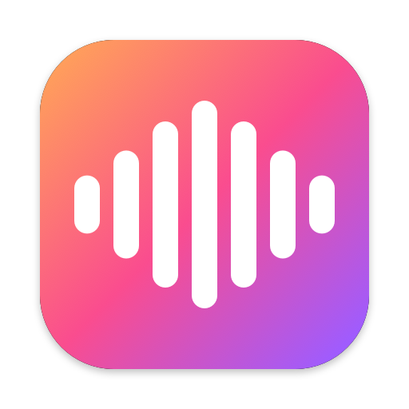

<h1> Utter</h1>

Local voice dictation for macOS. Hold **Right ⌘**, speak, release, and the text is pasted where your cursor is.

Transcription runs on your Mac with Whisper large-v3 turbo (via [whisper.cpp](https://github.com/ggml-org/whisper.cpp),
on the GPU). No account, no API key, no cost. The only network access is the one-time model download
from Hugging Face (~600 MB), plus update checks when you ask for them. The language is detected on every dictation.

## Install

1. **[⬇ Download Utter.dmg](https://github.com/vcamaral/utter/releases/latest/download/Utter.dmg)** (macOS 14 or later, Apple silicon).
2. Open the DMG and drag **Utter** into **Applications**.
3. Open Utter from Applications or Spotlight.

On first launch a setup window walks you through the **Microphone** and **Accessibility** permissions (Accessibility is
needed to see the dictation key in other apps and to paste) while the model downloads. Once downloaded, it loads in a
couple of seconds. If you open the app straight from the DMG, it offers to move itself into Applications.

### First launch

Utter isn't notarized by Apple yet, so macOS blocks it the first time. To allow it:

1. Open Utter and dismiss the warning.
2. Go to **System Settings › Privacy & Security**, scroll down and click **Open Anyway**.

You only need to do this once.

### Updates

**Check for Updates…** in the menu looks for a newer release on GitHub and offers to download it; open the new DMG and
drag Utter into Applications, replacing the old one. Your settings and permissions are kept. Utter only checks when
you ask.

## Usage

- Hold **Right ⌘** to record, release to transcribe and paste.
- Double-tap the key to dictate hands-free; tap it again to finish, or press Esc to cancel. It stops by itself after a minute of silence.
- Long dictations are transcribed in parts while you speak, so the text arrives about a second after you finish.
- Taps shorter than 0.3 s are ignored, and pressing another key while holding the dictation key cancels (so ⌘ shortcuts still work).
- Your clipboard is restored after pasting.
- If there is nowhere to paste, the text is left on the clipboard and Utter tells you to press ⌘V.

## Building from source

Requires Apple's Command Line Tools and `cmake` (`brew install cmake`). Xcode is not needed.

```bash
gh repo clone vcamaral/utter ~/Code/utter
~/Code/utter/install.sh
```

`install.sh` checks the prerequisites, builds the app into `~/Applications` and opens it. The first build compiles
whisper.cpp into `vendor/` (about 15 seconds); it's linked statically, so the app doesn't depend on Homebrew.

A build from a clone updates itself from that clone: it checks the git remote every couple of hours, pulls and builds
in the background, and restarts into the new version only after 10 minutes without dictating, so it never interrupts
you. **Check for Updates…** does it right away. It skips updating while the clone has uncommitted changes. Keep the
clone where you installed from; the log of the last update is in `~/Library/Logs/Utter-update.log`.

To package a release: `./scripts/make-dmg.sh` builds `build/Utter.dmg`. The DMG background
(`scripts/make-dmg-background.swift`) is drawn in code; the app icon comes from `scripts/make-icon.swift`.

## Diagnostics

Utter logs timings, detected languages and outcomes (never the dictated text):

```bash
/usr/bin/log show --last 1h --predicate 'subsystem == "com.vcamaral.utter"'
```

## Layout

| File | Role |
|---|---|
| `PushToTalk.swift` | Global hold/double-tap detection of the dictation key |
| `AudioRecorder.swift` | Microphone capture, resampled to 16 kHz mono |
| `Transcriber.swift` | Language detection and Whisper transcription (whisper.cpp) |
| `LiveTranscription.swift` | Transcribes long dictations in parts while recording |
| `ModelDownloader.swift` | One-time model download, checked against its SHA-256 |
| `TextInjector.swift` | Paste into the frontmost app, restore the clipboard |
| `MediaPause.swift` | Pause music while dictating, resume after |
| `RecordingOverlay.swift` | Floating waveform while recording |
| `SetupWindow.swift` | First-run permissions and download |
| `Updater.swift` | Self-update from the git clone, applied while idle |
| `AppDelegate.swift` | Menu bar UI and wiring |

Models live in `~/Library/Application Support/Utter`.

## License

MIT — see [LICENSE](LICENSE).
